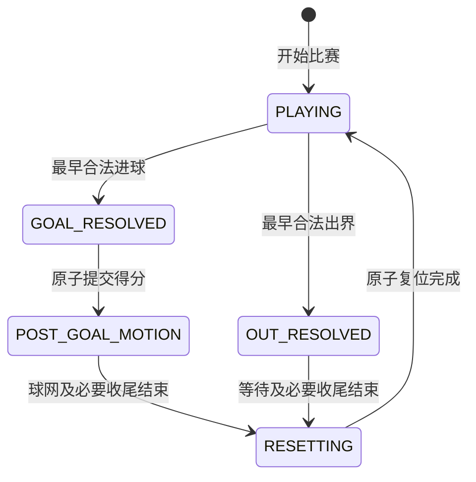

# Design

## Context

参见 [proposal.md](proposal.md)。本页为计划设计，不代表已实现。scenes/match/formal_match.tscn 当前只有空根节点；GameBootstrap 用于测试装配，GameLoop 驱动固定步，MatchSimulation 已有球权、比分与重置流程。FieldEnvironment 目前绑定四个测试角色，正式十二人表现不能只复用这组固定索引。原 autonomous-match 草案的基础需求迁至本特性，完整 AI 与词条分别另行验收。

已核对 Notion《程序架构》《模块接口》《进球、出界与重置》。后者仍是单人阶段设计，界外球、开球权和正式计时只有后续标题。本次继续复用越线、球网和统一重置，补充正式生命周期与 AI 阶段权限。当前结算期仍推进球员运行系统，所以仅停止新命令不足以阻止旧移动输入继续生效。

## Goals / Non-Goals

**Goals:** 正式装配与测试解耦；预设动作可验证十二人比赛、计时和输出；统一状态流转及 AI 的调用/命令权限，提供 AI/下注共同使用的比赛生命周期。

**Non-Goals:** 在本特性内实现战术自主决策、词条权重、赔率与筹码；不制作庆祝/跑回站位 AI、开球权、界外球、角球、球门球、上下半场、补时、加时或点球；不向正式比赛加入人工球员控制。

## Decisions

1. **复用模拟，独立装配。** 正式场景通过生产装配器创建现有 MatchSimulation、球员/足球系统与表现层；不实例化测试 GameBootstrap 或 scenes/test。共享领域类而非共享测试场景，避免正式与测试规则分叉。
2. **球队和阵容由本特性拥有。** 建立/加载 teams.csv、team_players.csv 及比赛时长配置，校验球员与球队引用、六人上场、一名门将、唯一 ID 和进攻方向；失败时不发布部分比赛。五场挑战以后引用这些表，不重复实现球队仓库。
3. **动作来源可注入。** 比赛基础接受统一 MatchAction 来源契约，验收通过无场景预设序列推进；正式球员输入只由后续 AI 装配。此阶段的可运行正式场景不代表全 AI Demo 已完成，完整自动比赛属于 add-player-ai。
4. **固定步终场。** 时长由 CSV 给出；暂停冻结模拟时间，正常与进球重置阶段沿用固定步时间推进。到点后原子性冻结比分、停止场上动作并提交一次结果；明确测试终场与进球/重置同一步的顺序，不能重复派发。比分只来源于 MatchSimulation。
5. **只读输出归基础层。** 快照包含比赛 ID、种子、固定步、比赛/回合阶段、时间、比分及正式结果；外部在完整步后读取。AI 和下注只消费此契约，读取不能触发随机调用或取得可写内部对象。
6. **Notion 文档落点。** 策划写专题设计页，程序设计写《程序架构》子页；全局架构与接口作为核对依据。默认使用解析、引用、非渲染装配及模拟测试。

### 比赛生命周期

保留比赛生命周期与回合阶段两层模型，避免暂停后丢失球网运动等回合信息。沿用 READY/RUNNING/PAUSED/FINISHED，新增 CANCELLED 区分异常取消与正常胜平负赛果。

| 生命周期 | 进入与退出 | 比赛时钟 | AI / 球员命令 |
| --- | --- | --- | --- |
| READY 开赛前 | 完整装配成功；显式开始或取消 | 初始为 0，不推进 | 不调用、不接受；流程放置球员和足球 |
| RUNNING 比赛中 | READY 开始或 PAUSED 恢复；可暂停、到时终场或取消 | 固定步推进 | 由回合阶段决定 |
| PAUSED 暂停 | 仅从 RUNNING 进入；恢复原回合或取消 | 全部冻结 | 不调用、不接受，不积累补跑时间 |
| FINISHED 正常终场 | RUNNING 到达时长；无后续流转 | 冻结 | 不调用、不接受，发布一次正式赛果 |
| CANCELLED 取消 | READY/RUNNING/PAUSED 被外层取消；无后续流转 | 冻结 | 不调用、不接受，只发布取消原因 |

装配失败不创建可运行比赛，不冒充已取消。终场与取消互斥；终态不能再开始、恢复或重复发布结果。新比赛使用新实例和比赛 ID，不调用测试重启清空旧结果。取消只提供事实，退筹码由下注特性处理。

### 回合状态与 AI 权限表

| RUNNING 内回合阶段 | 流程及结束条件 | 足球/球员推进 | 战术 AI |
| --- | --- | --- | --- |
| PLAYING 正常比赛 | 最早合法进球或出界时离开 | 正常动作、接触与规则 | 可以决策，个人资格仍由模拟校验 |
| GOAL_RESOLVED 进球确认 | 原子记录唯一进球及队比分，随后转球网运动 | 锁定结果，切断对抗与控球 | 关闭，失效旧意图 |
| POST_GOAL_MOTION 球网运动 | 既有球网运动结束，且必要扑救动作收尾后重置 | 只推进专用球网运动和已开始动作的收尾；无新移动、接球或对抗 | 关闭，不做庆祝或回位决策 |
| OUT_RESOLVED 出界确认 | 记录唯一出界，配置等待及必要收尾结束后重置 | 仅既有受控出界余动及动作收尾，不再触发控球/越线/对抗 | 关闭，失效旧意图 |
| RESETTING 重置 | 原子恢复完成后转 PLAYING | 足球回中点，全员回配置站位，清理瞬时动作与球权 | 关闭，由流程直接复位 |

GOAL_RESOLVED/RESETTING 可以是单步内瞬时状态，用有序事件记录，不要求界面展示独立帧。任一回合遇暂停全部冻结；遇终场/取消直接终止，不为等待扑救或球网而延长比赛。重置完成的同一步不再调用 AI，下一固定步依据新快照重新决策。

### AI 调度和命令准入

新增纯数据阶段权限查询，拟名 MatchControlPolicy，统一计算：

`can_decide_player_actions = phase == RUNNING && round_phase == PLAYING`

这是全场准入，倒地、受击、前后摇、球权、距离与冷却等个人资格继续由既有系统验证；门将共用同一阶段权限。AI 只能提出意图，不能将非法动作变合法。

通用动作来源拟提供 `propose_actions(snapshot) -> Array[MatchAction]`，GameLoop 负责调度。正式装配接后续 AI，单元测试可注入预设序列和带调用计数的假来源。没有 AI 时返回空动作并正常计时，不用专用测试追球 AI 冒充完整比赛。

每固定步先检查权限，再让所有来源读取同一快照并按稳定来源/球员 ID 顺序提出意图；模拟提交前再次检查当前权限和个人资格。开始、暂停、恢复、取消是外层生命周期控制，不属于球员意图；正式入口拒绝测试重置命令。

进入进球/出界结算、暂停、重置、终态时，清空待执行命令并中和持续移动输入。暂停保留动作进度，恢复重新决策，不重放旧 MOVE。停赛收尾仅推进已开始动作的必要时间，不执行新踢球、接触或伤害提交；不以“允许播完动画”为理由继续战术行为。

快照拟增加 round_sequence 与 control_revision；动作批次由调度器附上生成时的比赛 ID、步号、控制修订号。阶段切换递增修订，旧批次失效；AI 缓存/决策计时器也据此重新评估，不在禁用阶段积攒补跑次数。本特性不引入异步 AI，但该规则也拦截未来迟到的旧结果。禁用阶段不调用来源，绕过来源直接提交也无副作用、无随机抽样。

### 重置、站位和正式比分

开赛与进球/出界后的复位使用同一配置站位、中点自由球；不指定开球球队，不自动授予球权。下一 PLAYING 步按既有资格获得球权。

原子重置清理全部球员的移动输入、瞬时动作、受击/倒地恢复、传射前摇、待判抢断/攻击/头球/扑救意图，以及足球速度、高度、来源、接触锁、持有者和手持附件；门将面朝场内。只清理回合临时数据，不将未来体力、整场统计等持久比赛数据恢复初值。

保留比赛 ID、阵容、属性、累计时间/步号、正式比分、种子及随机源当前位置；回合编号递增，不重新播种。READY 初始就位不伪造进球或出界原因。

现有左门/右门计数是物理门统计。正式比分根据球队进攻方向，将穿越某门的得分计入进攻该门的队伍；不得把左门计数当作主队比分，也不依赖最近踢球者决定归属。

### 时钟与同刻事件顺序

比赛时长由 CSV 显式配置为正有限值。READY/PAUSED/终态不计时；RUNNING 的所有回合，包括进球、球网运动、出界等待与重置，都计入时长。暂停同时冻结动作、冷却、结算和随机源，不累积显示帧补算。

每步有效推进量为 `min(fixed_delta, duration - elapsed)`。只处理截止前的有效区间，计分区间为 `[0, duration)`，时间最终钳制到 duration，剩余时间为 0：

1. 截止之前的合法进球先记分，即使随后球网或扑救尚未播完，得分保留。
2. 恰好截止或之后的进球/出界不登记；同刻终场优先于重置，不再生成新回合开始。
3. 到点原子冻结比分，清除未提交意图与结算，发布一次正式结果。较早进球与终场在同一步时，事件按进球、截止前球网事件、终场排序。
4. GameLoop 在暂停/终场/取消后清空累计和队列，同一显示帧不能继续调用 AI 或推进新步。

使用既有数值容差并测试截止两侧，不由系统时间、场景回调或动画结束决定正式时间。

### 装配、只读契约与文档归属

teams.csv 管身份，team_players.csv 用 team_id/player_id/slot/default_position 管阵容；站位编码映射到版本化米制坐标。检查两队不同、每队六人且恰一门将、全场 ID 唯一、引用及站位合法、进攻方向相反；校验成功后再发布实例。

正式装配器不引用测试 GameBootstrap、scenes/test、测试预设或键盘球员适配器。FieldEnvironment 按稳定 player_id 管理十二个演员，共享投影、球网、足球和 HUD，保留旧测试模式。

快照增加比赛 ID、双方球队、正式队比分、时长/剩余时间、回合编号、控制修订号、AI 权限与终态结果，保留已有物理门计数兼容测试。状态变化及进球/出界/重置/终态事件携带比赛、时刻、步号、顺序与原因。结果不可变，读取不消耗随机源。FINISHED 才有主胜/平/客胜正式结果；CANCELLED 只提供取消事实和观察比分，下注方处理退款，不据观察比分结算。

实现新模块前，在 Notion《设计文档》下建立“正式比赛状态与流程”，在《程序架构》下建立“正式比赛状态与 AI 调度 — 程序设计”。全局架构只核对职责；实际接口实现后再摘要同步《模块接口》，不提前登记为已完成。

本特性拥有阶段权限与调度；add-player-ai 仅拥有 PLAYING 内的战术决策。其“十二名球员自主决策”应按本权限表限定，后续 AI 实现前同步其提案，不在本特性提前制作战术。当前未实现代码；专题设计已写入 Notion：[正式比赛状态与流程](https://app.notion.com/p/401f67bb9cfa81c192e2ebf6022b163a)、[正式比赛状态与 AI 调度 — 程序设计](https://app.notion.com/p/401f67bb9cfa8129a36ecfaebcbfb1eb)。

## Risks / Trade-offs

- **正式基础依赖全 AI 才能测试** → 预设动作注入只在测试使用，生命周期可先独立验收。
- **旧测试入口被正式装配引用** → 检查传递资源/脚本依赖，验证键盘适配器没有进入正式比赛。
- **终场与重置竞争** → 同一步唯一提交点，并覆盖平局、双方获胜、暂停和重置边界。
- **仅禁止新命令，旧移动仍生效** → 中和持续意图、失效队列，使用带计数假 AI 和停赛位置断言覆盖。
- **回合重置清掉整场数据或重播随机数** → 分别检查清理项和保留项，不复用正式比赛的测试重启。

## Migration Plan

依赖 complete-ai-match-demo 与 integrate-player-attributes-and-contests → Notion 专题文档与球队数据 → 生命周期/权限纯数据测试 → 回合结算与时钟 → 通用动作源/只读输出 → 正式十二人装配 → 预设整场验收。各组交付对应测试与专题文档，展示统一放现有测试模式，不单独新建模块测试场景。随后 add-player-ai 接入战术来源，add-player-traits 增加权重；下注对接只读接口。正式场景回退不影响已有测试入口。
